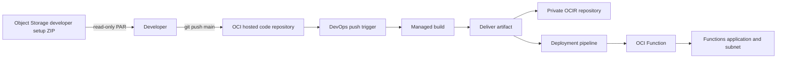

# Architecture

This stack provisions one OCI Functions application and one OCI DevOps project per `name_prefix`. The project owns a hosted Git repository, a managed build pipeline, a deployment pipeline, a push trigger, and an OCIR image artifact. The stack also creates a private OCIR repository, an Object Storage developer setup ZIP and read-only pre-authenticated request (PAR), a notification topic, and pipeline IAM resources.

The managed build runs `build_spec.yaml` from the root of the hosted repository. On its Oracle Linux 8 runner, Podman builds the application Dockerfile as `function:latest`; the deliver stage uploads that image to the private OCIR repository as `:latest`. The push trigger starts a build for pushes to `main`. Once Function deployment is enabled, a third build stage starts the deployment pipeline, which updates the Function to that image.

OCI requires a Function OCID to create a Function deployment environment. A new Function, in turn, needs an image already present in OCIR. The deployment pipeline container is therefore created in the first apply, but the Function, environment, deployment stage, and build-to-deploy trigger stage are added in a second apply after the first image delivery. The first successful build does not deploy; subsequent builds do.

For networking, `Define` creates a VCN and private regional subnet with a service gateway route to the Oracle Services Network. `Select` uses an existing private regional subnet. The Functions application attaches to that subnet. For developer setup storage, `Define` creates a private bucket; `Select` uses an existing bucket. A PAR grants read access to only the generated ZIP for the configured number of days after apply. The URL is a sensitive Terraform output and should be distributed accordingly.

The setup ZIP contains the generated script and a developer README. The script carries stack-derived IDs, names, registry settings, and Git URL. Each developer passes their full OCIR login username, local OCI CLI profile name, and auth token to `setup` at execution; none is placed in Terraform state or the ZIP. Its `setup` command configures Docker and an Fn context, `push` pushes the current `main` branch to the hosted repository, and `local-build` takes the developer's profile for the local Fn build and push flow described in DEV_SETUP.md. Pipeline builds use Podman and a repository Dockerfile.

OCI returns the hosted repository's HTTPS URL in the stack results. Terraform extracts its realm domain and uses it for the OCIR image path, the generated Fn context, and the Object Storage PAR URL. No government-realm input or realm mapping is required.

The stack creates a dynamic group and policy for the DevOps pipelines. During the second apply it also creates a dynamic group scoped to the new Function for resource-principal use, but grants it no access to other services because the function's resource needs are application-specific. Add only the required policy statements before code uses those services.
